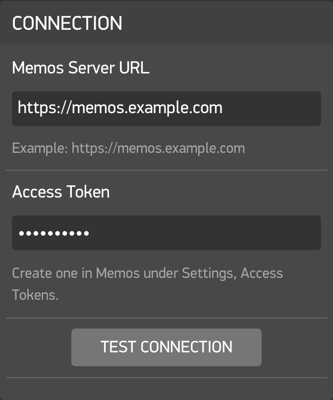
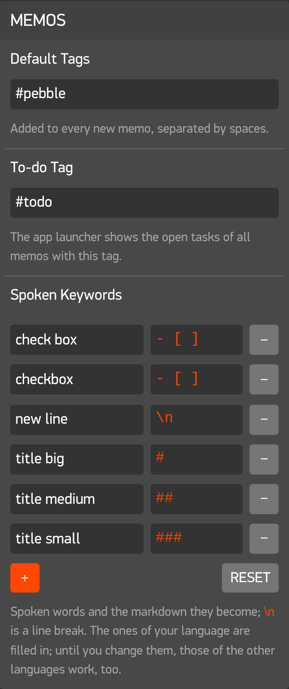
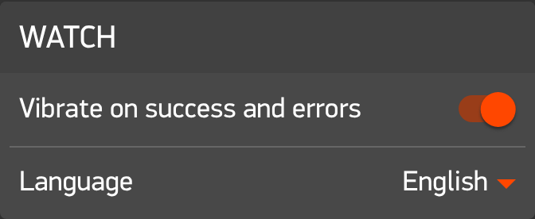

<p align="center">
  
</p>

##  Ostrakon

A Pebble watch app for your self-hosted [Memos](https://github.com/usememos/memos) server: dictate new memos, browse and search the ones you have, tick off tasks and add comments, all from your wrist.

An *ostrakon* is a piece of broken pottery that people in antiquity used to write short notes on, which is also where the app icon comes from.

**Homepage: [minils.de/ostrakon](https://minils.de/ostrakon/)**, with screenshots for every watch and a playground to try the spoken keywords in the browser.

<table>
  <tr>
    <th>Recent</th>
    <th>Memo</th>
    <th>Tasks</th>
    <th>Comments</th>
    <th>Comment</th>
    <th>Tags</th>
    <th>Glance</th>
  </tr>
  <tr>
    <td></td>
    <td></td>
    <td></td>
    <td></td>
    <td></td>
    <td></td>
    <td></td>
  </tr>
</table>

### Origin

Ostrakon started as a fork of [pebble-memos](https://github.com/erimow/pebble-memos) by [Erik Morris (erimow)](https://github.com/erimow), which inspired it; the code has since been rewritten. Thank you, Erik, for the idea of sending a dictated note straight from the watch to Memos!

### Features

**Writing**

* **New**: dictation starts right away. Dictate more, send or discard from the Select menu.
* **Drafts**: unsent memos are kept on the watch (up to three) and work without a phone connection. A memo that cannot reach the phone is saved as a draft automatically.
* **Offline queue**: if the phone has no internet, new memos are queued and sent as soon as it is back online.
* **Append** dictated text to an existing memo, or add a **Comment**.

**Reading**

* **Recent**, **Pinned** and **Tags** lists, 20 memos per page with *Load more*.
* **Search** by dictating a few words; the results show the search term in the title bar.
* Memos are shown with their **markdown** rendered: headings, task checkboxes, bullets, quotes, code and tags.
* **Long memos** are loaded page by page: the next part is loaded while you scroll towards the end.
* Select opens a memo right away; its menu (Tasks, Comments, Append, Pin, Archive, Delete …) is opened with Select in the memo, or with a long press in the list.
* **Comments** of a memo can be opened from its menu if it has any. They are listed with author and time and open with Select; each comment has its own menu to append to, archive or delete it, or to add a new comment.
* Recently loaded memos are cached on the phone, so lists and memos also open without internet.
* The watch keeps a small cache of the lists and memos opened last, so they can be read even without a connection to the phone. It only uses the storage the drafts leave free.

**Organizing**

* **Tasks**: list the checkboxes of a memo and tick them off; the change is saved to the server.
* **Pin / Unpin**, **Archive** and **Delete** (with confirmation).
* The **app glance** in the launcher shows the number of open tasks in all memos with your to-do tag.

**Languages**

The app speaks English, German, French, Spanish and Italian. By default it follows the language of the watch; the language can also be chosen in the settings.

**Watch support**

Built for all current Pebble platforms, including the new Core Devices watches: basalt, chalk, diorite, emery (Pebble Time 2), flint (Pebble 2 Duo) and gabbro (Pebble Round 2). On watches with a touchscreen, lists and memos can be scrolled by swiping.

### Spoken keywords

Some spoken phrases are turned into markdown when a memo is sent:

| Result | English | German | French | Spanish | Italian |
| --- | --- | --- | --- | --- | --- |
| a task, `- [ ] ` | checkbox, check box | Checkbox, Kontrollkästchen | case à cocher | casilla de verificación | casella di controllo |
| a heading, `#` | title big | Überschrift (or Titel) groß | grand titre, titre grand | título grande | titolo grande |
| a heading, `##` | title medium | Überschrift (or Titel) mittel | titre moyen | título mediano | titolo medio |
| a heading, `###` | title small | Überschrift (or Titel) klein | petit titre, titre petit | título pequeño | titolo piccolo |
| a line break | new line | neue Zeile | nouvelle ligne | nueva línea | nuova riga |
| the tag `#word` | hashtag *word* | Hashtag *Wort* | hashtag *mot* | hashtag *palabra* | hashtag *parola* |

These are the defaults. They can be changed under **Spoken Keywords** in the settings, which lists those of the app's language, one row of spoken word and markdown each: rows are added with **+**, removed with **−**, and **Reset** restores the defaults. `\n` in the markdown is a line break. For example *quote* with `>` turns "quote" into a quote, and *code* with `` \n```\n `` starts or ends a code block. Keywords only match whole words (so "code" leaves "barcode" alone) and are not case-sensitive; longer ones go first. Until the list is changed, the defaults of all languages work; after that, exactly the words in the list. The `hashtag` keyword always works.

### Settings

Open the app settings in the Pebble app on your phone:

<table>
  <tr>
    <th>Connection</th>
    <th>Memos</th>
    <th>Watch</th>
  </tr>
  <tr valign="top">
    <td></td>
    <td></td>
    <td></td>
  </tr>
</table>


* **Memos Server URL**, e.g. `https://memos.example.com`
* **Access Token**, created in the Memos settings
* **Test connection** checks URL and token. After saving, the watch also shows whether the connection works.
* **Default Tags** added to every new memo, e.g. `#pebble`
* **To-do Tag** whose open tasks the app glance counts, `#todo` by default
* **Spoken Keywords**: the spoken words for markdown, see *Spoken keywords*
* **Vibrate** on success and errors
* **Language**: automatic (the watch language), English, Deutsch, Français, Español or Italiano

### Development

The app has two parts: the watch app in C (`src/c`) and the phone part in PebbleKit JS (`src/pkjs`), which talks to the Memos API.

* Build with the [Pebble SDK](https://developer.repebble.com): `pebble build`
* Run the phone-side tests against a mock Memos server: `node test/pkjs.test.js`
* Screenshots of the settings page for this README: `node store/settings_screenshots.js` (needs [Playwright](https://playwright.dev) with Chromium)
* Translations: the watch texts are in `resources/lang/*.txt` (one file per language, loaded only for the language in use), the phone texts and the settings page in `src/pkjs/i18n.js`. Check the watch translations with `node test/i18n.test.js`.
* Sources are formatted with `clang-format` in Google style (see `.clang-format`); CI checks this
* The settings page is built with [Clay](https://github.com/pebble/clay) (MIT license), included in `src/pkjs/vendor`
* GitHub Actions runs the tests and builds the app on every push; the `.pbw` can be downloaded from the run's artifacts and installed from the phone.
* The homepage is in `site/`: plain HTML, CSS and JS without a build step, uploaded by hand. Its images are copies from `store/`, and its keyword playground has a copy of the parser in `src/pkjs/index.js`, so both need updating when those change.

### License

Ostrakon is released under the [MIT License](LICENSE). The bundled [Clay](https://github.com/pebble/clay) library is MIT-licensed as well, see `src/pkjs/vendor/CLAY-LICENSE`.
